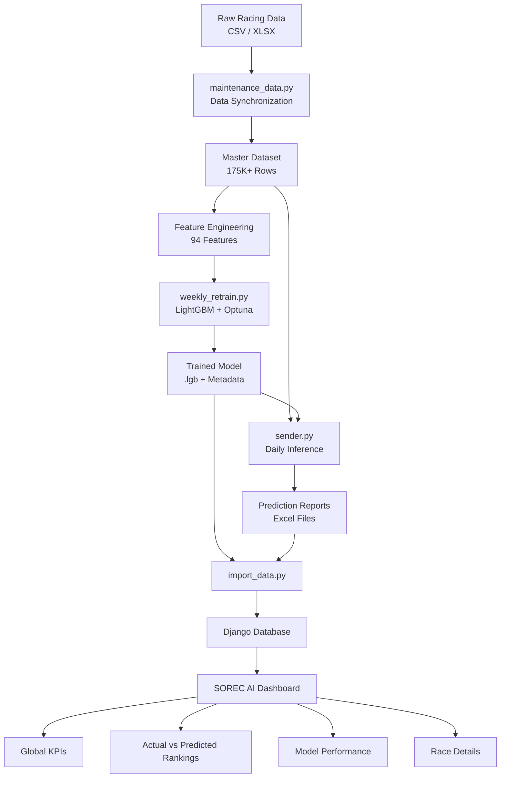
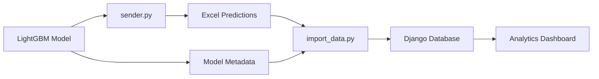

# 🏇 SOREC Horse Racing Prediction System & Analytics Dashboard

**An End-to-End Machine Learning Pipeline & Django Analytics Platform for Moroccan Horse Racing**

An intelligent horse racing prediction and monitoring platform designed to automate data synchronization, engineer racing features, predict horse performance probabilities, and monitor machine learning models through an interactive Django dashboard.

Developed as part of an engineering internship within the **Information Systems Transformation Department (DTSI) at SOREC – Société Royale d'Encouragement du Cheval, Morocco.**

---

## 📋 Table of Contents

- [Overview](#-overview)
- [Key Features](#-key-features)
- [System Architecture](#-system-architecture)
- [Machine Learning Pipeline](#-machine-learning-pipeline)
- [Model Evaluation](#-model-evaluation)
- [Dashboard Features](#-dashboard-features)
- [Technologies Used](#-technologies-used)
- [Project Structure](#-project-structure)
- [Installation & Setup](#-installation--setup)
- [ML Pipeline & Dashboard Integration](#-ml-pipeline--dashboard-integration)
- [Dashboard Pages & API](#-dashboard-pages--api)
- [Future Improvements](#-future-improvements)
- [Author](#-author)

---

## 📌 Overview

Predicting horse racing outcomes requires the analysis of historical race performances, horse characteristics, jockey statistics, and other racing-related variables.

This project provides an end-to-end solution combining **Data Engineering, Machine Learning, and Web Development** to automate the prediction and monitoring process.

The platform consists of two main components:

### 1. 🤖 Automated Machine Learning Pipeline

A Python-based pipeline responsible for:

- Synchronizing historical and daily racing datasets from Gamma System and eSOREC.
- Cleaning, transforming, and consolidating racing data.
- Engineering **94 domain-specific features**.
- Training and optimizing a LightGBM regression model using Optuna.
- Evaluating model performance and managing automatic model rollback.
- Generating daily horse ranking and win probability predictions.
- Exporting prediction reports and model metadata.

### 2. 📊 SOREC AI Monitoring Dashboard

A Django web application designed to:

- Visualize global prediction KPIs.
- Compare predicted rankings against actual race results.
- Monitor historical model performance.
- Track regression and ranking evaluation metrics.
- Explore individual race details.
- Filter historical predictions by date and racetrack.
- Expose REST-style JSON endpoints for prediction and performance data.

---

## ✨ Key Features

### 🤖 Machine Learning & Data Engineering

| Feature | Description |
|---|---|
| Automated Data Synchronization | Ingests and consolidates racing datasets from multiple sources. |
| Data Cleaning | Handles missing values, duplicates, and inconsistencies. |
| Feature Engineering | Generates 94 domain-specific racing features. |
| Model Training | Uses LightGBM for predictive modeling. |
| Hyperparameter Optimization | Uses Optuna with the TPE optimization strategy. |
| Model Evaluation | Tracks RMSE, MAE, R², and Top-3 Accuracy. |
| Automatic Model Rollback | Protects the production model against performance degradation exceeding the configured 5% threshold. |
| Daily Inference | Generates race-by-race predictions and probability estimates. |
| Automated Reporting | Exports prediction results into Excel reports. |

### 📊 Django Analytics Dashboard

- **Global Overview:** Centralized KPIs and historical prediction trends.
- **Prediction Rankings:** Actual vs. predicted Top-5 horse rankings.
- **Model Monitoring:** Historical tracking of model evaluation metrics.
- **Race Details:** Individual horse probability and ranking analysis.
- **Interactive Filtering:** Filter races by date and racetrack (hippodrome).
- **JSON API:** Access prediction rankings and model performance data.

---

## 🏗️ System Architecture

The platform follows a modular architecture connecting the Data Engineering pipeline, Machine Learning model, and Django monitoring application.



### Workflow Description

1. **Data Ingestion:** Collect historical and new racing data.
2. **Data Preparation:** Clean and synchronize datasets.
3. **Feature Engineering:** Generate predictive variables from racing history.
4. **Model Training:** Train and optimize the LightGBM model.
5. **Daily Prediction:** Generate predictions for upcoming races.
6. **Data Integration:** Import prediction reports and model metadata into Django.
7. **Visualization:** Display predictions, historical results, and performance metrics.

---

## 🧠 Machine Learning Pipeline

The Machine Learning component is organized around three main Python scripts.

### 1. Data Synchronization – `maintenance_data.py`

Responsible for maintaining the master racing dataset.

Main operations:

- Importing new racing files from CSV and Excel sources.
- Cleaning and standardizing incoming data.
- Handling missing values.
- Deduplicating and consolidating records.
- Updating the historical master dataset.
- Maintaining data consistency across synchronization cycles.

**Dataset Statistics:**

| Attribute | Value |
|---|---:|
| Total Records | 175,603+ |
| Number of Columns | 33 |
| Engineered Features | 94 |

*These figures represent the reported project dataset statistics.*

### 2. Model Training & Optimization – `weekly_retrain.py`

Responsible for periodically retraining and optimizing the prediction model.

**Model:** LightGBM Regressor

**Optimization Framework:** Optuna

**Optimization Strategy:** Tree-structured Parzen Estimator (TPE)

Main workflow:

1. Load the updated master dataset.
2. Prepare training and validation datasets.
3. Perform feature preparation.
4. Optimize LightGBM hyperparameters using Optuna.
5. Train the candidate model.
6. Evaluate the candidate against the current model.
7. Save the model and its metadata when the acceptance criteria are satisfied.
8. Apply automatic rollback when the configured degradation threshold is exceeded.

**Model Management:**

The pipeline implements a rollback mechanism with a configured 5% performance degradation threshold to avoid replacing a stronger model with an inferior candidate.

### 3. Daily Prediction – `sender.py`

Responsible for generating daily predictions for upcoming horse races.

Main operations:

- Loading the latest trained model.
- Preparing race-specific input features.
- Predicting a performance score for each horse.
- Converting prediction scores into normalized probability estimates using Softmax.
- Generating horse rankings.
- Exporting detailed Excel prediction reports.
- Dispatching automated reports.

**Probability Normalization:**

The Softmax function is used to normalize prediction scores:

\[
P_i = \frac{e^{s_i}}{\sum_{j=1}^{n}e^{s_j}}
\]

Where:

- \(P_i\): Estimated probability for horse \(i\).
- \(s_i\): Prediction score for horse \(i\).
- \(n\): Number of participating horses.

The resulting probabilities sum to 100% within each race.

*Note: Softmax normalization does not, by itself, guarantee statistically calibrated win probabilities.*

---

## 📈 Model Evaluation

Model performance is monitored through regression and ranking metrics.

### Regression Metrics

| Metric | Description |
|---|---|
| RMSE | Root Mean Squared Error, penalizing larger prediction errors. |
| MAE | Mean Absolute Error across predictions. |
| R² | Coefficient of determination, measuring explained variance. |

### Ranking Metric

| Metric | Description |
|---|---|
| Top-3 Accuracy | Measures the model's ability to identify horses satisfying the project's Top-3 evaluation criterion. |

### Reported Performance

| Metric | Reported Result |
|---|---:|
| RMSE | ~0.1641 |
| Top-3 Accuracy | ~59.4% |
| Evaluated Races | 2,806 |

These results are based on the project's reported evaluation data.

---

## 📊 SOREC AI Dashboard

The Django application provides a centralized monitoring interface for exploring predictions and evaluating model performance.

### Dashboard Overview

Displays the platform's main KPIs, including:

- Total processed races.
- Prediction accuracy indicators.
- Historical performance trends.
- Recent racing activity.
- Global model statistics.

### Actual vs. Predicted Rankings

Provides a comparative analysis between predicted and actual horse rankings.

Features:

- Side-by-side Top-5 comparison.
- Race date filtering.
- Racetrack filtering.
- Historical ranking analysis.

### Model Performance Monitoring

Displays the evolution of machine learning evaluation metrics:

- RMSE.
- MAE.
- R².
- Top-N ranking accuracy.
- Model metadata and architecture information.

### Race Detail View

Provides detailed information for individual races:

- Participating horses.
- Predicted probabilities.
- Predicted rankings.
- Actual results.
- Horse-by-horse performance comparison.

---

## 🛠️ Technologies Used

### Machine Learning & Data Engineering

| Technology | Purpose |
|---|---|
| Python | Main programming language |
| Pandas | Data manipulation and preprocessing |
| NumPy | Numerical computations |
| LightGBM | Gradient Boosting predictive model |
| Optuna | Hyperparameter optimization |
| Scikit-learn | Machine learning utilities and evaluation |
| OpenPyXL | Excel file processing |

### Web Development & Backend

| Technology | Purpose |
|---|---|
| Django | Backend framework |
| Python | Application logic |
| Django ORM | Database interaction |
| HTML / CSS / JavaScript | Dashboard interface |
| JSON | Data exchange and API responses |
| SQLite / Configured Database | Persistent data storage |

*The actual database engine and frontend libraries depend on the project configuration.*

---

## 📂 Project Structure

```text
horse-racing-predictor/
│
├── Projet_Sorec/
│   │
│   ├── data/
│   │   ├── new-races/
│   │   │   └── # Incoming daily racing datasets
│   │   │
│   │   └── results-treated/
│   │       └── # Processed racing result files
│   │
│   ├── model/
│   │   ├── maintenance_data.py
│   │   ├── weekly_retrain.py
│   │   └── sender.py
│   │
│   └── logs/
│       └── # Synchronization and execution logs
│
├── sorec_dashboard/
│   │
│   ├── dashboard/
│   │   └── # Django models, views, templates and URL routes
│   │
│   ├── sorec_dashboard/
│   │   └── # Django settings and application configuration
│   │
│   ├── import_data.py
│   └── manage.py
│
└── README.md
```

---

## ⚙️ Installation & Setup

### Prerequisites

Make sure the following tools are installed:

- Python 3.10+
- pip
- Git
- Virtual Environment

### 1. Clone the Repository

```bash
git clone https://github.com/Ghitaa444/horse-racing-predictor.git

cd horse-racing-predictor
```

### 2. Create a Virtual Environment

```bash
python -m venv venv
```

**Windows:**

```bash
venv\Scripts\activate
```

**Linux / macOS:**

```bash
source venv/bin/activate
```

### 3. Install Dependencies

```bash
pip install django pandas numpy openpyxl lightgbm optuna scikit-learn
```

### 4. Initialize the Django Database

```bash
cd sorec_dashboard

python manage.py makemigrations dashboard

python manage.py migrate
```

### 5. Start the Development Server

```bash
python manage.py runserver
```

Open the application in your browser:

```text
http://127.0.0.1:8000/
```

---

## 🔗 ML Pipeline & Dashboard Integration

The Machine Learning pipeline and Django dashboard communicate through generated Excel prediction reports and serialized model metadata.

### 1. Import Daily Predictions

```bash
python import_data.py predictions --file predictions_16_06_2026_details.xlsx
```

This command imports the generated race predictions into the Django database.

### 2. Import Model Metadata

```bash
python import_data.py meta --file models/horse_racing_regressor.lgb.meta.pkl
```

This command imports the model's metadata and evaluation information.

### Integration Workflow



---

## 🖥️ Dashboard Pages & API

| Page | URL | Description |
|---|---|---|
| Overview | `/` | Global KPIs, historical trends and recent races |
| Ranking | `/ranking/` | Actual vs. Predicted Top-5 rankings with filters |
| Metrics | `/metrics/` | RMSE, MAE, R², Top-N accuracy and model information |
| Race Detail | `/course/<id>/` | Detailed horse-by-horse prediction analysis |

The application also exposes JSON endpoints for retrieving ranking and historical model performance information.

---

## 🚀 Future Improvements

Potential extensions to the platform include:

- **Automated Scheduling:** Integrate scheduled execution for daily predictions and weekly retraining.
- **Advanced Model Comparison:** Benchmark LightGBM against XGBoost, CatBoost and other algorithms.
- **Probability Calibration:** Improve the statistical reliability of predicted win probabilities.
- **Advanced Feature Engineering:** Incorporate additional horse, jockey, trainer and racetrack indicators.
- **Model Explainability:** Integrate SHAP to interpret model predictions.
- **API Development:** Expand the REST API for external system integration.
- **Deployment:** Containerize the application using Docker.
- **Advanced Monitoring:** Add automated alerts for data quality issues and model performance degradation.

---

## 👩‍💻 Author

**Ghita EL Finou**

Data Engineering & AI Bachelor Student  
École Supérieure de Technologie – Béni Mellal (EST Béni Mellal), Morocco.

**Areas of Interest:**

- Data Engineering
- Machine Learning & Artificial Intelligence
- Data Science
- Backend Development
- Predictive Analytics

**GitHub:** [@Ghitaa444](https://github.com/Ghitaa444)

---

## ⭐ Acknowledgements

Special thanks to **SOREC (Société Royale d'Encouragement du Cheval)** and the **Information Systems Transformation Department (DTSI)** for providing the professional environment and opportunity to work on this engineering project.

---

<p align="center">
  <b>Built with Python, Machine Learning & Django 🏇</b>
  <br>
  <i>Transforming racing data into predictive insights.</i>
</p>
